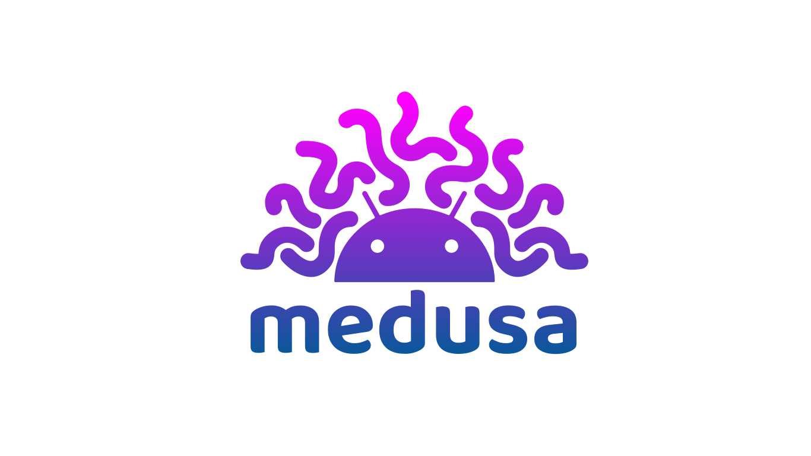

## Sponsored by:
<br>
<a href="https://mobilehackinglab.com" target="_blank" rel="noopener noreferrer">
<picture>
  <source media="(prefers-color-scheme: dark)" srcset="https://raw.githubusercontent.com/Ch0pin/medusa/master/assets/images/sponsors/mhl_white.png">
  
</picture>
</a>
<br>
<br>

# MEDUSA

A modular automation framework and script repository for runtime testing and investigating Android and iOS apps, designed for penetration testers and malware analysts. It lets you plug in modules to bypass protections (like SSL pinning), inspect network/WebView activity, trace API calls, examine memory/crypto, and monitor malware behavior — all from a single coordinated script. It runs on FRIDA under the hood and ships with 100+ reusable modules so tests scale and repeat easily.

# Installation

**System requirements:** 

- Linux or macOS (limited functionality available on Windows)
- Python 3.12 or newer
- Node.js and npm (for building the Java and ObjC bridges)
- adb and a Frida-compatible Android or iOS device
- FRIDA server (running on the mobile device)

**Installing from github:** 

1.	Clone this repository.
2.	CD into the medusa directory.
3.	Install dependencies:

For the unified development version, use the `dev` branch. Replace `/path/to/medusa` below with the absolute path to your checkout.

```sh
python3 -m venv /path/to/medusa/.venv
/path/to/medusa/.venv/bin/python -m pip install -r /path/to/medusa/requirements.txt 
# Or for mcp support
/path/to/medusa/.venv/bin/python -m pip install -r /path/to/medusa/requirements-mcp.txt 
npm --prefix /path/to/medusa ci
npm --prefix /path/to/medusa run build:bridges
```

The bridge build produces the Java and ObjC agents used with Frida 17. Rebuild them after changing their npm dependencies. The Python runtime and development lockfiles record the tested dependency sets.

Or download the latest stable version from [here](https://github.com/Ch0pin/medusa/releases)

# Usage

Medusa consists of two modules: `medusa` and `mango`. What follows is a description about their usage.

## MEDUSA
Use the unified launcher for Android and iOS:

```sh
/path/to/medusa/medusa
```
After start, MEDUSA will enumerate available devices and let you pick one.

Device OS detection selects the Android or iOS commands. Use `loaddevice` to switch platforms within the same process, retaining each platform's staged work. An explicit override is available through `--platform android` or `--platform ios`.

### Development checks

```sh
/path/to/medusa/.venv/bin/python -m pip install -r /path/to/medusa/requirements-dev.lock.txt
/path/to/medusa/.venv/bin/python -B -m unittest discover -s /path/to/medusa/tests
```

Ruff and mypy are configured in the project metadata with an incremental scope for the new CLI/core code. Tests cover original command definitions, startup output, platform switching, generated-agent retention, compilation output, and script lifecycle behavior. Device-specific runtime coverage remains separate from these host tests.

Common interactive workflow

```sh
# list available commands or get help about a specific command
medusa> help      # or help <command-name>

# list available modules
medusa> show all 

# get quick help/details about a module
medusa> info http_communications/ssl-pinning-bypass

# add a module (Tab completes module paths)
medusa> use http_communications/      # press [Tab] to autocomplete

# list installed packages on the device
medusa> list

# instrument a package (by package name)
medusa> run -f com.my.app

# show available devices and select one
medusa> loaddevice
```

## MANGO 

Medusa’s lightweight companion CLI for static prep and automation — manifest parsing, attack-surface enumeration, app tracking, and simple device/proxy automation.

Run `python3 mango.py <database-name>` to create or load a database for storing Mango’s results.

```sh
# show available devices and select one
mango> loaddevice

# pull an app (by package name)
mango> pull com.my.app 

# import an app for analysis
mango> import /path/to/apk
```

## MCP Server Support

This is optional and not required for the standard Medusa CLI workflow.

To use the Android MCP server (`medusa_android_mcp.py`), install the MCP requirements and run:

```sh
MEDUSA_MCP_TRANSPORT=streamable-http python medusa_android_mcp.py
```

#### Configuration:

```json
"medusa-android": {
   "type": "http",
   "url": "http://127.0.0.1:8000/mcp"
}
```


**For advanced usage and examples, see our [wiki](https://github.com/Ch0pin/medusa/wiki). For quick tips and introductory workflows, check the demos below:**


- [MEDUSA | Android Penetration tool](https://www.youtube.com/watch?v=4hpjRuNJNDw) (credits [@ByteTheories](https://www.youtube.com/@ByteTheories))
- [MEDUSA | Android Malware Analysis 101](https://www.youtube.com/watch?v=kUqucdkVtSU) (credits [@ByteTheories](https://www.youtube.com/@ByteTheories))
- [Unpacking Android malware with Medusa](https://www.youtube.com/watch?v=D2-jREzCE9k) (credits [@cryptax](https://twitter.com/cryptax))
- [Unpacking Android APKs with Medusa](https://www.youtube.com/watch?v=ffM5R2Wfl0A) (credits [@LaurieWired](https://twitter.com/LaurieWired))
- [#Medusa - Extensible binary instrumentation framework based on #FRIDA for Android applications](https://www.youtube.com/watch?v=Hon7zETJawA) (credits [@AndroidAppSec](https://www.youtube.com/@AndroidAppSec))
- [Memory inspection with Medusa](https://www.youtube.com/watch?v=odt21wiUugQ)
- [Bypassing root detection](https://twitter.com/ch0pin/status/1381216805683924994)


# How to Contribute:

You can contribute to this project by:
- Becoming a [sponsor](https://github.com/sponsors/Ch0pin) 
- Creating a medusa module (see [how to](https://github.com/Ch0pin/medusa/wiki/Medusa#creating-a-medusa-module))
- Making a pull request
- Reporting an error/issue 
- Suggesting an improvement
- Making this project more popular by sharing it or giving a star


# Screenshots

- SSL Unpinning


- Intent Monitoring 


- Webview Monitoring


- File/Content provider monitoring


- Native Libraries Enumeration


- Memory READ/WRITE/SEARCH (interactive mode):


# CREDITS:

- Special Credits to [@rscloura](https://github.com/rscloura) for his contributions
- Logo Credits: https://www.linkedin.com/in/rafael-c-ferreira
- https://github.com/frida/frida
- https://github.com/dpnishant/appmon
- https://github.com/brompwnie/uitkyk
- https://github.com/shivsahni/APKEnum
- https://github.com/0xdea/frida-scripts
- https://github.com/Areizen/JNI-Frida-Hook
